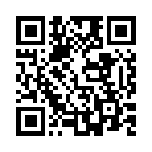

# PocketScan v7

Phone barcode scanner that collects codes with photos and shares them as a PDF.

Live: https://javaftw.github.io/PocketScan/

Scan with your phone to open it:

## Application

Buildless HTML, CSS and JavaScript in `dist/`. No installation or build is
needed to serve the application. Camera access needs HTTPS (or localhost).

- Minimal camera controls, flash and sound toggle.
- Warehouse 1D barcodes: Code 128, Code 39, Code 93, ITF and Codabar. Retail
  EAN/UPC product codes are not searched. Code 39, ITF and Codabar have no
  mandatory checksum, so they are only accepted after two matching reads.
- ZXing decodes in a background worker (`decode-worker.js`), so scanning never
  stalls the camera preview or the buttons. Without worker support it falls
  back to decoding on the page.
- Duplicate skipping, undo and clear.
- Tap-to-focus, mild zoom and continuous or single-shot autofocus where the
  browser allows camera control.
- Open the page with `?debug` to show decoder speed and camera settings.
- Device-local barcode/photo storage.
- PDF sharing: two-column table, barcode left and uncropped photograph right.
- Three-note scan confirmation melody.

## Tests

The Node test tools require `sharp` and `@napi-rs/canvas`:

    npm install --no-save sharp@0.33.5 @napi-rs/canvas@1.0.10
    node --check dist/app.js
    node --check dist/scanner.js
    node --check dist/decoder.js
    node --check dist/decode-worker.js
    node --check dist/media.js
    node tests/scanner-smoke.cjs
    node tests/share-smoke.cjs
    node tests/report-smoke.cjs

The report test writes sample files to `/tmp`; adjust those test paths for
Windows.

## Deployment

Every push to `main` publishes `dist/` to GitHub Pages through
`.github/workflows/pages.yml`.

Scans and photos stay in each device's browser storage and are never uploaded.
